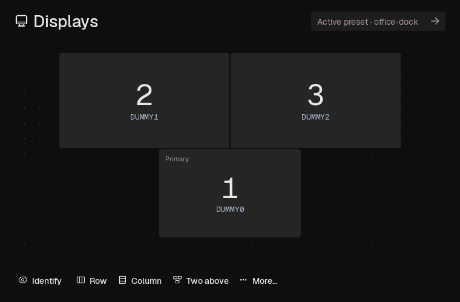
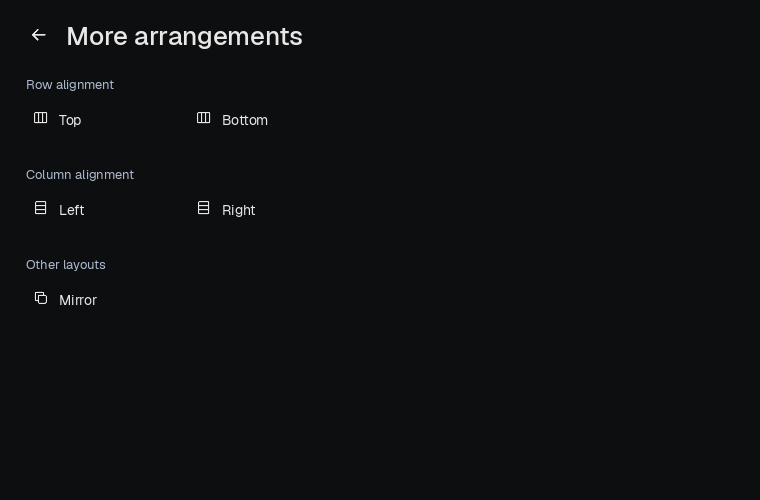
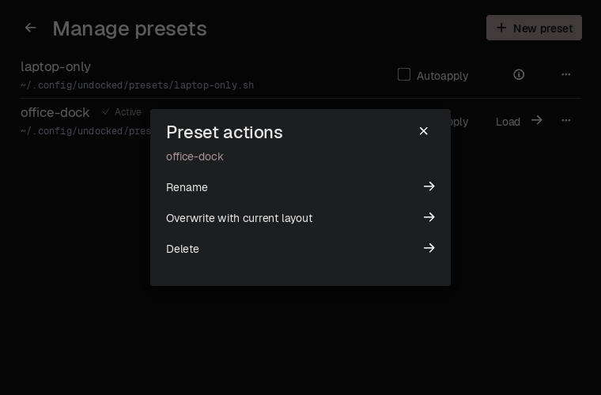
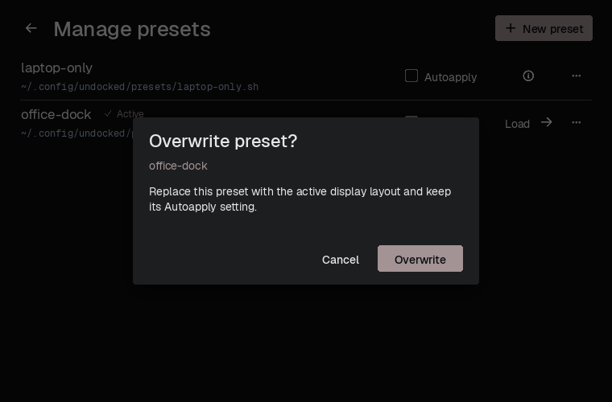
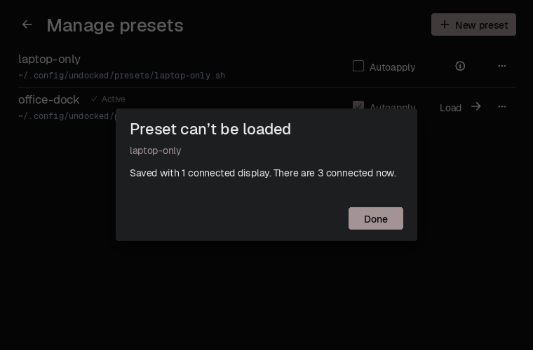

# Undocked

Arrange your X11 displays, save layouts, and switch automatically when your dock
changes. Undocked puts the display editor and hotplug watcher in one
C program. It talks to RandR directly and uses [CUI](https://github.com/mattmezza/cui)
for the editor.



## Install

```sh
curl -fsSL https://raw.githubusercontent.com/mattmezza/undocked/main/install.sh | sh
```

The installer verifies a checksum and installs a statically linked Linux binary
for x86_64 or aarch64 in `~/.local/bin`. Run it again to upgrade, or pass a version
with `sh -s -- v0.1.1`. Set `PREFIX` to choose another install prefix. You need
an X11 session with RandR 1.3 or newer.

Open the editor with `undocked`. For automatic switching, start the daemon from
your X session startup script.

```sh
undocked daemon &
```

The editor uses the `Undocked` window class and the X11 dialog type so mwm opens
it centered and floating. The installer refreshes a running daemon in the
current X session. Existing `tray` settings can be removed from `config.ini`.

## Arrange displays

- Drag the numbered displays to arrange them. Edges snap together. Use the arrow
  keys to move the selected display, or hold Shift for larger steps.
- Click **Identify** to see the same numbers on the active screens. Connector
  names appear on the layout, including for disabled displays.
- Click a display to open its full-height settings drawer. Select its resolution
  to browse the supported modes. The editor shows rates close to whole numbers
  as **60 Hz**, for example, when that label identifies a single mode. JSON and
  presets keep the exact RandR rate.
- **Row**, **Column**, and **Two above** are shortcuts below the layout. Row
  centers displays vertically, Column centers them horizontally, and Two above
  appears for three displays. **More…** lists every available arrangement,
  including those shortcuts, the other alignments, and Mirror or Extend.
- Click **Apply** and then **Keep**. Undocked restores the previous layout if the
  countdown expires. If the old layout is unavailable, it tries a connected
  output at a supported mode.
- Click the active preset name on **Displays** to open **Manage presets**.
  Presets that match the current, confirmed layout are marked **Active**.
  When several presets match, Displays shows the number of matches.
  From this screen you can load a layout, see its script path, or toggle
  **Autoapply**. An info button explains why a preset is unavailable.
  **New preset** saves the active layout and turns spaces in the name into dashes.
  Use the **…** button on a preset to rename it, overwrite it with the active
  layout, or delete it. Overwriting preserves **Autoapply**. Overwrite and
  delete ask for confirmation.












## Presets and configuration

Copy [config.ini](config.ini) to `$XDG_CONFIG_HOME/undocked/config.ini`
(default `~/.config/undocked/config.ini`). The file lists the defaults. Keep
this directory in Stow to sync the settings and executable `presets/*.sh` files.
Run a preset script directly, choose it from the editor, or call
`undocked preset office-dock`. Undocked reads the saved layout records from
the script when matching or applying it.

Automatic matching uses the full connected set, including outputs a preset
leaves disabled. Undocked uses the monitor's EDID and the connector name. A
unique EDID can follow a display to a different connector unless
`match_ports = true`. Identical EDIDs and displays without EDID use connector
names. If several automatic presets match, choose one for autoapply. An
unrecognized setup keeps its usable layout.

To reapply a wallpaper, set `after_change` under `[undocked]` and run
`undocked reload`. The hook runs after each settled display change, including a
preview, a rollback, and changes from other X11 clients. Keeping an already
settled preview adds no hook run. The hook receives `DISPLAY`,
`UNDOCKED_REASON`, and `UNDOCKED_PRESET`.

```ini
after_change = if [ -r "$HOME/.fehbg" ]; then sh "$HOME/.fehbg"; fi
```

Undocked ships Geist and Geist Mono. It inherits the mwm Xresources palette
and supports `undocked.background`, `panel`, `foreground`, `muted`, `border`,
`accent`, `onAccent`, `warning`, and `cornerRadius`. Set `corner_radius` under
`[ui]` to override the Xresources radius. The default is 4 px. Set
`undocked.font` and `undocked.mono` to font file paths, or use the corresponding
INI settings. Display numbers, connector names, resolutions, and refresh rates
use the mono face.

Set `quick_arrangements` under `[ui]` to choose and order the shortcuts. Leave
it empty to use **More…** for every layout. Set `drawer_animation_ms = 0` to
open the drawer immediately.

## Launch and scripts

Add this to [Launch](https://github.com/mattmezza/launch)'s `config.ini`.
Search for a saved preset, Mirror or Extend, an arrangement, or an action for a
specific connector such as **Disable DP-1** or **Make DP-1 primary**. Resolution
and refresh-rate changes open a second picker with the connector's supported
modes. Layout changes open Undocked for **Keep** or **Revert**, and both options
are also available in Launch while confirmation is pending.

```ini
[workflow Displays]
keywords=monitor screen dock preset mirror resolution enable disable refresh rate
command=undocked launch
```

```sh
undocked status --json
undocked presets --json
undocked save office-dock --auto
undocked overwrite office-dock
undocked preset office-dock --dry-run
undocked preset office-dock               # then run keep or revert
undocked layout row --yes                 # bottom aligned
undocked layout column-right --yes
undocked output DP-1 mode 2560x1440@60
undocked output DP-1 primary
undocked identify
undocked recover
undocked rename office-dock new-office-dock
undocked delete new-office-dock
```

Run `undocked --help` for the full command list. JSON output carries a schema
version, and commands report failure through their exit status.

A window manager such as mwm can use the same CLI from the user's X11 session.
Run `undocked` to open the editor, `undocked launch` for the action menu, or
`undocked identify` to show display numbers. Use `status --json` for display
state and `presets --json` for saved presets and whether they match. The CLI
connects to the session daemon and starts it on demand when needed.

## Build

Source builds need a C11 toolchain, make, pkg-config, and the X11, RandR,
FreeType, and HarfBuzz development libraries. CUI and the fonts are bundled.

```sh
make
make check
sudo make clean install
```

`make check` uses Xvfb and xdotool. `make release name=v0.1.1` pushes a version
tag. GitHub Actions builds, tests, and publishes the static binaries for both
architectures with their checksums.

Undocked is [MIT-licensed](LICENSE). It currently supports X11. The layout and
preset model is independent of the display backend.
